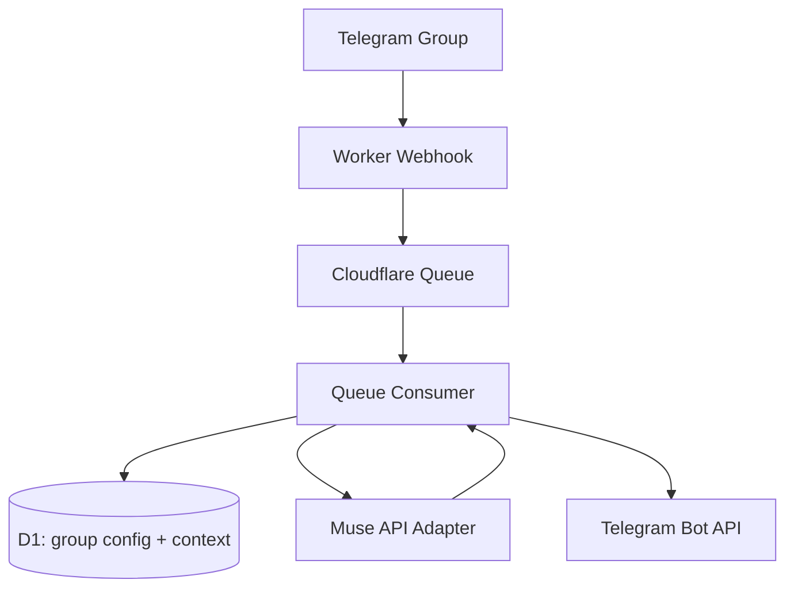

<div align="center">
  
  <h1>✨ Muse Telegram Bridge</h1>
  <p><strong>Bring Muse into Telegram groups.</strong></p>
  <p>A queue-backed, serverless bridge connecting Telegram conversations to your Muse AI runtime.</p>
  <p>
    
    
    
  </p>
</div>

## 🌌 What is this?

Muse Telegram Bridge makes Muse available inside Telegram group chats. It is deliberately a **transport layer**: Muse remains responsible for intelligence, tools, and model execution, while this bridge handles webhooks, routing, group context, media transfer, and response delivery.

### Features
- 💬 **Mention-first** — mention Muse, use `/muse`, or reply to Muse.
- 🧵 **Conversation context** — recent group messages are assembled when Muse is invoked.
- 🖼️ **Attachment forwarding** — retrieve Telegram media and pass it to a configurable Muse adapter.
- 🧠 **Group isolation** — settings and context are scoped by chat ID.
- ⚙️ **Admin controls** — enable/disable Muse and switch mention/all mode.
- 🔄 **Queue-backed** — webhook returns quickly; AI processing runs asynchronously.
- ☁️ **Serverless-first** — Cloudflare Workers, Queues, and D1.

> **API compatibility:** Muse's exact endpoint and media contract must be confirmed. The included adapter is Responses-style and isolated in `src/muse.ts` for easy replacement.

## 🧭 Architecture



## 🗣️ Interactions

| Trigger | Behaviour |
|---|---|
| `@Muse ...` | Mention Muse |
| `/muse <question>` | Invoke directly |
| Reply to Muse | Continue a conversation |
| `/musehelp` | Commands |
| `/musesettings` | View group settings |
| `/musesummary` | Recap recent discussion |
| `/musemode mention` or `all` | Change mode (admin) |
| `/museon` / `/museoff` | Enable/disable (admin) |

Mention mode is the default. `all` requires Telegram to deliver ordinary group messages to the bot.

## 📎 Media

The bridge downloads Telegram attachments via `getFile`, applies a configurable size cap, and forwards data URLs to Muse. Photos are represented as image inputs; other media as file inputs. Actual formats supported depend on your Muse endpoint.

## 🚀 Deploy

**Prerequisites:** Node.js 20+, Cloudflare account/Wrangler, a Telegram bot from [@BotFather](https://t.me/BotFather), and a Muse endpoint/key/model.

1. Install and configure:
   ```bash
   npm install
   cp .dev.vars.example .dev.vars
   ```
2. Create resources:
   ```bash
   npx wrangler d1 create muse-telegram-bridge
   npx wrangler queues create muse-telegram-updates
   npx wrangler queues create muse-telegram-updates-dlq
   ```
   Add the D1 database ID to `wrangler.toml`.
3. Apply schema:
   ```bash
   npx wrangler d1 migrations apply muse-telegram-bridge --local
   npx wrangler d1 migrations apply muse-telegram-bridge --remote
   ```
4. Add secrets:
   ```bash
   npx wrangler secret put TELEGRAM_BOT_TOKEN
   npx wrangler secret put TELEGRAM_WEBHOOK_SECRET
   npx wrangler secret put MUSE_API_KEY
   ```
5. Deploy: `npm run deploy`
6. Register webhook:
   ```bash
   curl -X POST "https://api.telegram.org/bot<TOKEN>/setWebhook" \
     -d "url=https://<worker-domain>/telegram/webhook" \
     -d "secret_token=<WEBHOOK_SECRET>" \
     -d 'allowed_updates=["message","edited_message"]'
   ```

## 🔧 Configuration

| Variable | Purpose |
|---|---|
| `TELEGRAM_BOT_TOKEN` | Telegram bot token (secret) |
| `TELEGRAM_WEBHOOK_SECRET` | Webhook secret (secret) |
| `MUSE_API_URL` | Muse-compatible endpoint |
| `MUSE_API_KEY` | API key (secret) |
| `MUSE_MODEL` | Model identifier |
| `MUSE_API_MODE` | Currently `responses` |
| `MAX_MEDIA_BYTES` | Attachment cap; default 8 MiB |
| `CONTEXT_MESSAGES` | Recent context; default 20, max 50 |

## 🧩 Muse adapter

`src/muse.ts` posts a Responses-style payload. Images use `input_image` data URLs and attachments use `input_file`. If Muse's API contract differs, change this adapter without touching Telegram routing.

## 🔐 Privacy

- Mention-only is the default.
- Full group-message mode should be enabled only with group consent.
- Recent group context is stored in D1; define retention before using in sensitive groups.
- Secrets belong in Cloudflare secrets, never committed.
- This uses the official Telegram Bot API—not personal-account automation.

## 🛠️ Local development

```bash
npm run dev
npm run typecheck
npm test
```

## 🗺️ Roadmap

- [x] Webhook + queue
- [x] Mention / command / reply routing
- [x] D1 group config and context
- [x] Attachment forwarding adapter
- [ ] Confirm Muse API contract
- [ ] Debounce rapid group messages
- [ ] Return generated files/images to Telegram
- [ ] Streaming / typing improvements
- [ ] Long-term group memory and retention controls
- [ ] Guided onboarding

## License
MIT — see [LICENSE](LICENSE).
